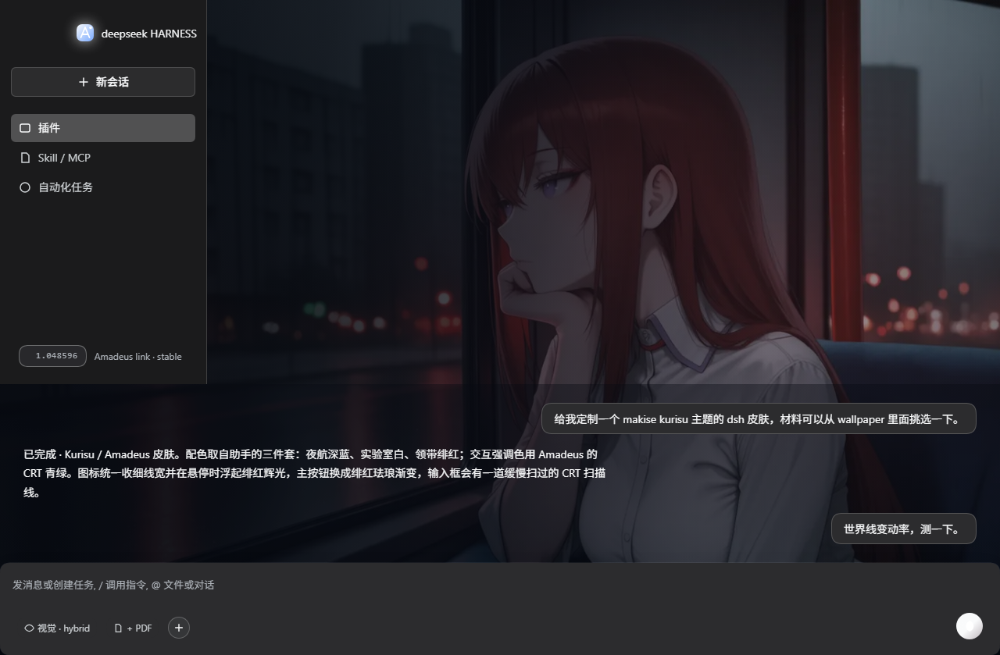
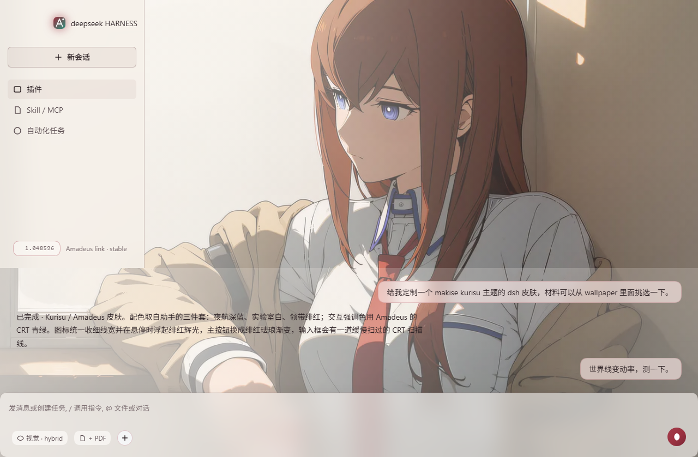
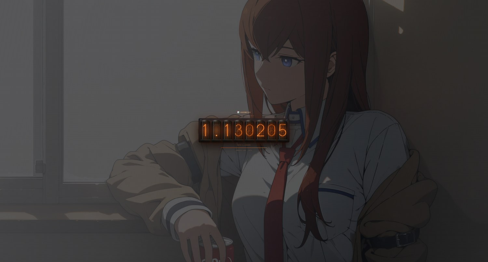
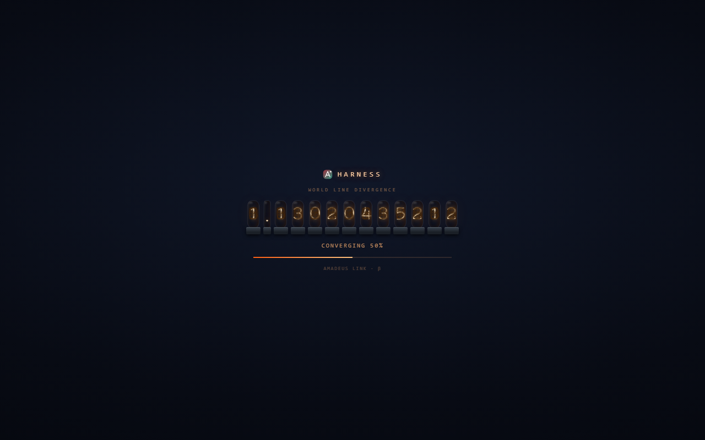

# Makise Kurisu · DSH Skin

牧濑红莉栖（Makise Kurisu / Amadeus）主题的 DSH 皮肤。深色模式是「夜航列车」的深蓝与绯红，
浅色模式是实验室白与暖奶油；交互强调色用 Amadeus 的 CRT 青绿，避免整屏只剩红色。
壁纸全部取自本机 `wallpaper-tool/images` 里的牧濑红莉栖图库，可随浅色 / 深色模式自动换图，
也可以在 **设置 → 通用 → Makise Kurisu** 里手动切换。

v1.1 追加了图标、按钮与动效层：侧栏品牌徽记换成 Amadeus 徽章，图标统一收细线宽并在悬停时
浮起绯红辉光，发送键换成珐琅渐变，输入框有一道缓慢扫过的 CRT 扫描线，滚动条 / 焦点环 /
代码块换成实验室终端风格；侧栏底部还有一颗可点击切换世界线的 **1.048596** 变动率计。





---

## 1. 设计

| 角色 | 颜色 | 用途 |
| --- | --- | --- |
| 夜航深蓝 | `#06080f` / `rgba(7,10,18,.52)` | 深色底、浮层、正文面板 |
| 实验室白 | `#f4eee6` / `rgba(250,246,241,.46)` | 浅色底、卡片、输入框 |
| 领带绯红 | `#9c3140`（浅）/ `#e0919c`（深） | 品牌色、发送按钮、选中态 |
| Amadeus 青绿 | `#2f8f7c`（浅）/ `#6fc7b5`（深） | 连接状态、业务强调、焦点辅助 |
| 暖灰墨 | `#2b2023` / `#f3ede9` | 主文字，保证在壁纸上的对比度 |

皮肤只覆盖 alias 层 token（125 个），没有改动任何组件源码。
壁纸画在 AppFrame（`div.MnhYfG_frame`）的 background 层上——它是内置 `root` slot、
自带一层不透明底，`body` 上的图会被它整块盖住。会话链路中间几层的底色被清成透明，
只在会话列上留一层薄纱，于是半透明侧栏 / 面板会自然透出画面，
而聊天正文、代码块、输入框仍然是可读的高对比表面。

### 壁纸

四张素材都来自本地图库，按 1600×900 裁切并压成 WebP（46–166 KB）：

| 名称 | 源文件 | 默认用于 |
| --- | --- | --- |
| 夜行列车 | `牧濑红莉栖-07.png` | 深色模式 |
| 白昼窗边 | `牧濑红莉栖-08.png` | 浅色模式 |
| 薄暮荒原 | `牧濑红莉栖-09.png` | 手动选择 |
| 星夜图书馆 | `牧濑红莉栖-10.png` | 手动选择 |


### 按运行中 DOM 校准（v1.8）

v1.7 有三处没生效，根因是**我按缓存里的旧 CSS 猜类名**。这一轮改成从运行中的应用直接取事实：
客户端临时挂一个诊断上报器，把真实 DOM 的 class / rect / computed style POST 到本地 sink，
再据此改 CSS。取到的关键事实：

| 现象 | 真实情况 |
| --- | --- |
| 收起按钮 | 我的 `top:5px` 其实**生效了**，但它的 `fixed` 包含块不是视口，而是从第二行（y=40）开始，所以落在 y=45。改成 `top:-35px` 后实测 `rect=10,5,28,28`，回到窗内第一行 |
| 「已编辑 N 个文件」卡片 | `[class*="_panel"]` 命中的全是**侧栏导航**。真实类是 CSS-module 的 `<hash>_card`，且可见表面是 header 的 `--changes-fill` |
| 下滑圆钮 | 我的 `[class*="_toBottom"]` 是对的（当前构建仍有 `_9ibABa_toBottom`），之前 grep 落空是 asar 读取脚本的 offset 类型 bug |
| DS Bot 图标 | `avatar/bot/agent` 全落空。真实入口是 `[data-agent-id]`（行级语义属性），图标是 `currentColor` 描边 |

因此最终选择器改为**抗哈希**的写法：

```css
[data-windows-titlebar]:not(:has([data-sidebar-collapsed="true"])) [class*="_toggle"] { top:-35px; left:10px }
[data-ks-wall="on"] [class$="_card"] { --changes-fill:transparent; background:color-mix(...52%...) }
[data-ks-wall="on"] [class*="_toBottom"] { --dsw-alias-button-floating-fill: color-mix(...56%...) }
[data-ks-wall="on"] [data-agent-id] svg, [data-ks-wall="on"] [data-agent-id] img { filter:grayscale(.55) sepia(.45) … }
```

`[class$="_card"]` 只匹配以 `_card` 结尾的类（代码块卡片是 `_card_7gxqk_107`，结尾是 `_107`，不会误伤）；
`[data-agent-id]` 是该插件自己的语义属性，不受构建哈希影响。

### DS Bot 图标：渐变填充，只能靠 filter（v1.8.4）

查清了三层误判，记下来避免再犯：

- 它**不是** `avatar/bot/agent` 类，也不是 `[data-agent-id]`
- 它**不是**纯色，`--bt-accent` 改了没用 —— 真实结构是
  `span.bt-mark > svg > g.bt-b`，鲸鱼用 **`fill="url(#bt-mark-1)"` 渐变**填充
- 渐变无法用 `fill` 覆盖，变量也管不到，唯一有效手段是滤镜

所以最终规则只按 ds-bot 自己的稳定类名写：

```css
[data-ks-wall="on"] .bt-mark,
[data-ks-wall="on"] .bt-mark svg {
  filter: grayscale(.55) sepia(.5) saturate(2.1) hue-rotate(-14deg) brightness(1.04);
}
```

**像素验证**：鲸鱼区域（105,723,20,20）从 `138 蓝 / 0 暖` → `0 蓝 / 113 暖`。

同时把 ds-bot 的调色变量接到主题上（面板、chip、按钮一起收敛）：
`--bt-accent #ffa028`、`--bt-ink-deepseek #ff8a1f`、`--bt-green #41c7b9`。

### 收起按钮：撤回改动（v1.8.1）

两次尝试都失败，且各有明确原因，最终按用户要求回到原始位置：

| 尝试 | 结果 | 原因 |
| --- | --- | --- |
| `top:5px` | 落在 y=45（第二行） | 它的 `fixed` 包含块不是视口，而是从第二行开始 |
| `top:-35px` | 按钮整个消失 | 被那个包含块 `overflow` 裁掉 |
| 撤回 | rect 回到出厂行为，按钮可见 | 像素扫描确认左边缘 x≈18 处重新出现图标 |

### 直接改 app.asar：让主题从第 0 秒就存在（v1.9）

宿主注入只能在启动末尾产出，所以原生画面占了前 ≈27s。既然接受改 asar，就改在源头。

**先确认安全前提**（`rea inspect_electron_fuses`）：

```
EnableEmbeddedAsarIntegrityValidation: disabled   ← 内容改动不会被校验拦下
OnlyLoadAppFromAsar:                  disabled
```

**改的是**：`resources/app.asar → lib/web-document.js → LOADING_STYLE`

这段是 `serveWebDocument()` 在把 `index.html` 交给渲染器时**内联插入 `<head>`** 的样式，
也就是原生 splash 的唯一着色来源（原本是纯黑 `#000` + 浅灰字）。

**手法：等长原地替换**

- asar 头里存的是每个 entry 的 `offset/size`，只要长度不变，其余 20285 个 entry 全不受影响
- 原串 512 字节、纯 ASCII；新串严格 512 字节，差值用 `<style>` 标签**内部**的 CSS 注释补齐
  （放在标签外面会变成 head 里的可见文字）
- 只覆写 512 字节，不重写 180 MB 归档

**替换后的主题样式**（保留壳自己的真实进度环，只换色）：

```css
html:has([data-dsh-boot]),body:has([data-dsh-boot]){background:#0a0d11}
[data-dsh-boot]{background:radial-gradient(120% 90% at 50% 38%,#1b1410,#0a0d11 62%,#05070a);
  color:#ffe9c4;--dsw-alias-label-primary:#ffe9c4;--dsw-alias-label-secondary:#e7b784;
  --dsw-alias-label-tertiary:#b98a5e;--dsw-alias-brand-primary:#ffa028}
[data-dsh-boot-spinner]{filter:drop-shadow(0 0 10px #ff7a00)}
```

**校验**：

```
size 180923876（未变）| header parses, entries=20286
LOADING_STYLE bytes=512 | themed=true | exports intact
web-document.js → node --check 通过
```

**回滚与更新**：

```powershell
node research/patch-asar-splash.mjs --restore   # 写回原始 512 字节
```

原始字节备份在 `asar-original-loading-style.txt`。**DSH 升级会覆盖 app.asar**，升级后重跑
`node research/patch-asar-splash.mjs` 即可（幂等）。

### v1.11：辉光管读数、原生启动屏与无缝交接

三处一起改，对应「读数末尾零太多 / 启动屏只换了颜色 / 载入后画面不连贯」。

**① 读数不再补零（8 管）**

旧版把 β 世界线补成 12 位 `113020500000`，13 支管显示 `1.13020500000` —— 末尾 5 个零。
现在按 S;G 分歧计原型回到 **8 支管（1 位整数 + 1 支小数点管 + 6 位小数）**：

| 位置 | 旧 | 新 |
| --- | --- | --- |
| 启动屏 | `1.13020500000`（13 管） | `1.130205`（8 管） |
| 侧栏变动率计 | 同上 | β `1.130205` / Steins Gate `1.048596` / α `0.334581` … 全是 7 位有效数字 |

- `src/client.template.js`：`NIXIE_CELLS = 7`、`V4_TUBES = 8`，`digitsOf()` 不再补零
- `src/host.template.js`：`BETA = "1130205"`，`tubes = 8`
- `src/sg-nixie.inline.js`：`lockProgress()` 缺位改成**熄灭管**（`' '`）而不是补 `'0'`
- 五条世界线本身都是 7 位有效数字，任何一条都不会再出现尾部零

**② app.asar：原生启动屏彻底辉光管化**

v1.9 只做了 512 字节等长原地替换，只改颜色；前 ≈27s 的原生画面仍是壳自己的卡片 + 转圈。
这一版不再受等长约束，改用**头部手术**（header surgery）：

- `lib/web-document.js` 的 `LOADING_STYLE` 是 `serveWebDocument()` 往首个 `<head>` 里
  **原样插入**的字符串，所以它可以包含 `<style>` 和 `<script>`，且会在 t=0 执行
- 把该 entry 的 `offset/size` 指到归档末尾追加的新内容，只重写头部 JSON（补齐到原
  `jsonSize`），其余 20285 个 entry 的 offset/size 一个不动 —— 不重打包 180 MB；
  删掉该 entry 的 `integrity`（fuse 已禁用 asar 完整性校验）
- 新 `LOADING_STYLE` = 完整 `#ks-loadscreen`（徽记 + 8 管读数 + 真实进度条 + 文案）
  + v4 `sg-nixie` 组件 + 构建器；背景用与 AppFrame **同一张壁纸**，上覆一层暗纱
- 幂等 / 可回滚：`node research/patch-asar-splash.mjs --dry-run | --apply | --restore | --verify`

**③ 载入 → 载入后：一条连续画面**

关键不是「再画一个启动屏」，而是**从头到尾只有一块 `#ks-loadscreen`**：

| 时刻 | 谁在画 | 发生什么 |
| --- | --- | --- |
| t=0 | asar 注入 | 建 `#ks-loadscreen`，暴露 `window.KS_SPLASH`，读壳的 `--dsh-boot-arc` 收敛 8 管 |
| ≈27s | 宿主注入 | `LOAD_SCRIPT` 调 `KS_SPLASH.adopt()` 接管同一元素，**不再创建第二块板**；注入行里去掉了 `kind:"html"` 行 |
| 应用就绪 | 宿主 | 先置 `data-ks-ready="1"`，等 React 在不透明层下画好两帧，再 700ms 淡出 |

- 淡出时暗纱随之揭开，露出的是**同一张壁纸**，所以是渐变揭示而不是切换背景
- 客户端插件检测到 `#ks-loadscreen` 就让位（`dropFirstFrameMask` / `takeOverSplash` 都不再叠一层），
  并在 `data-ks-ready` 时给侧栏那颗 8 管表一次琥珀点火脉冲（`ks-meter-arrive`），
  读数从屏幕中央「落」进侧栏
- 校验：`preview/verify-v1.11.html`（由 `preview/make-v111-harness.mjs` 从**真实构建产物**生成），
  headless Chrome 断言全过：单覆盖层 / 单表 / 8 管 / `chars=1.130205` / 接管 /
  `data-ks-ready` / 淡出 / 侧栏 `1.048596`



> 改的是 asar 和宿主插件，**必须重启 DSH** 才生效；DSH 升级覆盖 app.asar 后重跑
> `node research/patch-asar-splash.mjs --apply` 即可（幂等）。

### 辉光管：换成 v4 写实组件（v1.10.1）

素材来源：`<home>\AppData\Roaming\Cindy\...\steins-gate-nixie-assets`
（另一个 agent 做的；原始 9 个文件已原样备份到 `assets/nixie-v4/` 保留出处）。

v4 是零依赖 Web Component：Shadow DOM + 单笔画 SVG 数字字形（源自
owenisas/steins-gate-world-line，MIT）+ 每管五层结构（管外光雾 / 暗阴极堆 /
双层描边点亮层 / 前方导线 / 蜂窝阳极网 + 前玻璃）+ `LAYER` 前后阴极消隐算法
+ 电流声 hum 动画 + 物理点火时序。数字不依赖字体。

**整合方式**：原组件默认 8 管（`1.XXXXXX`），皮肤需要 12 位 + 小数点 = 13 管，
所以在 `src/sg-nixie.inline.js` 里加了一层薄补丁，**v4 的 CSS / 字形 / 消隐算法一行未改**：

| 补丁 | 作用 |
| --- | --- |
| `tubes` 属性 + `_rebuild(n)` | 管数可变；`--nx-tw` 用 `--nx-count` 计算 |
| `--nx-count` 写在 Shadow DOM 的 `<style>` 里 | 自定义元素构造期间不能给宿主加属性，`this.style` 会抛 `NotSupportedError: The result must not have attributes` |
| `noignite` 属性 | 关掉组件自带点火动画，让启动屏用真实 `--dsh-boot-arc` 驱动 |
| `lockProgress(p, digits)` | 进度左侧锁 β 数字、右侧继续随机滚动 |
| `customElements.get` 守卫 | 宿主注入和客户端插件都带同一份源码，避免重复 define |

**构建**：`build.ps1` 把 `src/sg-nixie.inline.js` 以 JSON 字符串内联进
`lib/client.js` 和 `lib/index.js`；宿主多推一行 `{kind:"script"}` 组件脚本，
且必须排在加载屏脚本之前（`PZ` 按行序执行）。`NIXIE_CSS` 现在只剩尺寸/换肤
（通过 `::part(panel)`），管壁渲染全在 Shadow DOM 内。

**验证**（`preview/v4-check.html`、`v4-boot-check.html`、`v4-boot-frozen.html`）：

```
v4-check        : 13 管 / boot + 侧栏两种尺寸 → title "v4 OK"
v4-boot-check   : 按 PZ 真实方式注入 4 行 → "v4boot OK tubes=13 chars=1.13020046563"
                  （进度 0.5 → 前 6 位已锁 β，后 6 位仍滚动）
真实应用探针   : defined=true | meters=1 | tubes=13 | chars=1.13020500000
                  litUse=26 | rect=65,767,150,23
宿主启动记录   : meter-created(api-ok) → built(tubes=13) → progress(1.00)
                  → finish → disposed
```

踩过的坑：`sg-nixie.js` 的用法注释里含 `<script src=...></script>`，用裸 HTML
内联会被提前截断；真实宿主走 `script.textContent`，不受影响。演练页必须按
`PZ` 的 `textContent` 方式注入才等价。

### 收起按钮：和「应用 / 编辑」同一行（v1.9.3）

先查清为什么两次 CSS 尝试都失败（DOM 探针实测）：

```
--dsh-windows-titlebar-height = 40px        ← 应用/编辑 那行是 y=0..40
TOGGLE  position:fixed; top:6px; left:12px; z-index:30
        rect = (12,46,28,28)                ← 实际落在第二行
anc0 bJOniG_logoRow      rect 12,46,256,40   overflow:hidden
anc3 MnhYfG_sidebarCol   rect 0,40,280,800   overflow:hidden
                                            backdrop-filter:blur(26px)
```

`backdrop-filter` 让 `sidebarCol` 成了 `position:fixed` 的**包含块**，起点 y=40，
所以 `top:6px` 变成 y=46。而 `top:-35px` 虽然算到 y=6，又被 `logoRow` /
`sidebarCol` 的 `overflow:hidden` 裁掉 —— 这就是「按钮消失」的原因。

**结论：纯 CSS 挪不动它。** 最终方案是镜像按钮：

- 原按钮保留在 React 树里，加 `.ks-toggle-source` 设 `visibility:hidden`
- 克隆一份挂到 `document.body`（`fixed` 重新相对视口解析），
  `top:6px; left:12px; z-index:2147483000` → 落在 y=6，即第一行
- 点镜像时 `src.click()` 转发给原按钮；React 的事件委托在 `#root`，功能不变
- `MutationObserver` + 5s 轮询同步图标，防 React 重渲染换掉节点

DOM 验证：

```
src    rect=12,46  vis=hidden  reactProps=1  aria=收起侧边栏
mirror parent=body rect=12,6,28,28 pos=fixed z=2147483000 vis=visible
hitCenter=svg.bJOniG_panelIcon   ← 顶层元素，可点，未被遮挡
```

### 文件附件卡透明度（v1.8.8）

`md6BpW_file` 的底色走 `--deliverable-fill`（`dsw-static-neutral-50`，近纯白不透明），
跟皮肤其它玻璃层不是一套。用 `[class$="_file"]` 把它接到同一个玻璃公式：

```css
--deliverable-fill:  color-mix(in srgb, var(--dsw-alias-bg-layer-2) 52%, transparent);
--deliverable-hover: color-mix(in srgb, var(--dsw-alias-bg-layer-2) 66%, transparent);
backdrop-filter: blur(14px) saturate(1.06);
```

computed style 实测：附件卡 `0.218` / 改动卡 `0.218` / 输入区卡 `0.218` —— 三者完全一致。

### 加载屏：实测结论（v1.8.6）

开机记录把整条时间线量出来了（`preview/report.jsonl`，单位 ms，相对页面导航）：

```
27469  script-start        ← 注入脚本开始执行
27470  built               mount=1 tubes=12 shell=1 shellHidden=1 arc=1 progress=0.000
27472  ticker-armed
28653  progress(1.00)
29298  progress(0.70)      ← 壳的第二波加载把 arc 重置了
29298  finish              shell=0
31297  disposed
```

对照宿主日志：

| 时刻 (UTC) | 事件 | 距进程启动 |
| --- | --- | --- |
| 12:59:38.3 | host.start / spawn | 0s |
| 12:59:57.7 | `boot injection registered` | ≈19s |
| 13:00:05.4 | `rows pushed` + `Host ready` | ≈27s |

**结论：主题加载屏确实生效了，但它只能覆盖启动的最后 ≈4s；前面 ≈27s 是原生画面。**

原因是架构性的：注入行由宿主在启动完成时产出（`webserver/index-inject` → `Ms.ready()` → `PZ`），
而原生 splash 在 t=0 就由壳自己创建，并且由 `web-document.js` 里写死的
`LOADING_STYLE`（黑底 + 浅色字）上色 —— 那段只有 `#dsh-next-loading-style`，
是应用自己的静态字符串，没有用户扩展点。

想缩短原生画面，唯一有效的杠杆是**缩短宿主启动时间**（当前一次启动 ≈27s，其中大量插件 + MCP 服务器串行就绪）。
顺带修了进度回退：壳会在第二波加载时把 `--dsh-boot-arc` 重置，现在用 `Math.max(raw, lastProgress)` 钳成单调。

### 加载屏：自带开机记录（v1.8.5）

不再靠肉眼判断。注入脚本现在写一条**开机时间线**：

| 事件 | 含义 |
| --- | --- |
| `script-start` | 注入脚本被执行（说明 `kind:"script"` 行生效） |
| `no-mount-element` | 找不到 `#ks-loadscreen`（说明 `kind:"html"` 行没生效） |
| `built` | 13 支管 + 徽章已挂载 |
| `progress` | 进度收敛采样（每 25% 一次） |
| `finish` / `disposed` / `ceiling` | 交接、移除、12s 兜底 |
| `ticker-armed` | 定时器已启动 |

每条携带 `mount/tubes/shell/shellHidden/arc/progress` 快照。写两个地方：

1. `localStorage["ks-boot-tl"]`（**兜底**：收集端没开也不会丢）
2. `POST http://127.0.0.1:8791/report`（收集端 `preview/serve.mjs`，落 `preview/report.jsonl`）

客户端在激活 600ms 后会把 localStorage 里没消费过的那条**补发**一次，所以即使开机时收集端不在，下一次激活也能补上。

同时从 asar 里核实了渲染端代码，注入链路是通的：

```js
async function PZ(rows, loadSrc) {
  for (const r of rows) switch (r.kind) {
    case "script": { const s = document.createElement("script"); s.textContent = r.text;
                     (r.placement === "head" ? document.head : document.body).append(s); break }
    case "style":  { const s = document.createElement("style"); s.textContent = r.text; document.head.append(s); break }
    case "html":   (r.placement === "head" ? document.head : document.body).insertAdjacentHTML("beforeend", r.html); break
    default: throw new Error("unknown index injection row")
  }
}
```

三种 kind 都被处理，未知 kind 会直接抛错（不会静默失败）。宿主日志已证明
`rows pushed (total rows=15)`，所以「产生 → 交付 → 应用」三段现在都有证据。

### 加载屏：宿主侧已就绪，待一次真实重启确认

`lib/index.js` 现在会在启动时写一行 `boot injection registered (3 rows)`，每次注入再写
`boot rows pushed to index-inject table`。模块本身已单独验证：导出 `name/inject/apply`、
注册 `webserver/index-inject`、推入 `style,html,script` 三行都正常。

重启后查 `<home>\.dsh\logs\desktop-next.log` 搜 `kurisu`：
有 `registered` 无 `pushed` → 宿主没走到收集阶段；两行都有但界面仍是原生 → 渲染端没应用。

### 细节打磨（v1.7）

四处针对性修正，全部用**结构化选择器**（哈希前缀会随构建变化，后缀不会）：

| 项 | 做法 |
| --- | --- |
| 收起按钮位置 | Windows 下它原本 `position:fixed` 垂直居中于整个标题带，而那个带比一行高，所以它飘在菜单行和 logo 行之间。展开态改为 `top:5px; left:10px` 钉到左上角；折叠态**保持原状**——折叠时窗口菜单会右移让位（`--dsh-windows-menu-start`），上移反而会撞菜单 |
| 文件改动卡片 | 卡片底色来自 `--dsw-specific-menu`。只在 `[class*="_dock"] [class*="_panel"]` 作用域内把它改成 `color-mix(bg-layer-2 68%, transparent)`，别处菜单不受影响 |
| 下滑圆钮 | 底色来自 `--dsw-alias-button-floating-fill`，只在 `[class*="_toBottom"]` 内改到 56% / hover 72%，并补 `backdrop-filter: blur(12px)` |
| DS Bot 图标 | `agent-team-profile/icon.svg` 是固定色（蓝/橙/青四块）。用 `svg:has(> path[fill="#F2AF63"])` 精确命中这个图标（不误伤其他图标），整体 `grayscale→sepia→hue-rotate` 暖化成 Amadeus 色调 |
| 顶/底灰字 | `--dsw-alias-label-secondary/tertiary` 调深，并补上原本没覆盖的 `-caption` / `-dimmed` / `-primary-dimmed`（这几项才是顶部元信息条和底部状态栏用的） |

验证（synthetic DOM + computed style）：卡片底色 43.5% 透明、定制属性全部落位、
`toggle=5px/10px`、`logoRow padding-left=8px`、图标 filter 生效、tertiary `#635559`、caption `#6b5c60`。

### 加载屏改由宿主注入（v1.6 —— 真正的修法）

前两版都在**客户端插件**里做加载屏，这是根本性错误：加载屏是 shell 在**任何客户端插件激活之前**
就建好的，而且随时可能被 React 清掉。客户端插件天生够不到那个时间窗口。

正确的接缝在宿主侧。desktop 的启动链路是：

```
electron main  IPC.boot
  -> runtime.injections()
    -> Next Host:  ctx.webServer.collectIndexInjections()
         emits "webserver/index-inject"  (table)      <- 插件在这里 push 行
    -> 渲染进程 PZ(rows) 按顺序应用 style / html / script
```

`<style>` / `<html>` / `<script>` 三类行都在页面引导阶段落地，**早于应用挂载**。

所以 `lib/index.js` 从空实现变成了真正的宿主插件：

```js
export const name = "dsh-skin-kurisu";
export const inject = ["webServer"];

export function apply(ctx) {
  ctx.inject(["webServer"], (webCtx) => {
    webCtx.on("webserver/index-inject", (table) => {
      table.push({ kind: "style", text: NIXIE_CSS + LOAD_CSS });
      table.push({ kind: "html", placement: "body", html: '<div id="ks-loadscreen"></div>' });
      table.push({ kind: "script", placement: "body", text: LOAD_SCRIPT });
    });
  });
}
```

- 加载屏是**纯 ES5 脚本 + 自己的 fixed 层**，挂在 `<body>`，与 `#root` 无关
- 数字进度仍读 shell 自己的 `--dsh-boot-arc`（72°→288°），即真实插件加载进度
- shell 原卡片只做 `visibility: hidden`
- 整体外包 try/catch：皮肤永远不能拖住宿主启动
- 客户端侧保留 `.ks-splash` 作为兜底，检测到 `#ks-loadscreen` 就直接让位，绝不画两套

**管子 CSS 由 build.ps1 从 `src/client.template.js` 里裁出来注入 `lib/index.js`**，
所以加载屏和界面内的辉光管是同一份定义，不会各自漂移。

> 这一版是**宿主插件**改动，必须**重启 DSH** 才会生效；插件开关的重载只重建客户端模块。

### 加载屏修复：不要往 #root 里塞东西（v1.5.1）

v1.3.1 的接管方式是把辉光板 **append 进 shell 的 splash 卡片**。那张卡片在 `#root` 里，
而应用挂载时会清空 `#root`——板子被连根拔掉，表现为「变暗一闪 → 板子消失 → 黑着等应用」。

页面内时间线实测（打点，不是肉眼判断）：

```
board-add tubes=13 dot=1 @63ms
root-cleared        @913ms      ← React 挂载清空 #root
board-remove        @1412ms
```

现在的结构：

- **板子是我们自己的 fixed 层**，append 到 `document.body`，`z-index: 2147483500`；
  应用对 `#root` 做什么都动不到它
- shell 自己的卡片只是 `visibility: hidden`（`[data-ks-boot="true"] [class*="_card"]`）
- 何时撤：轮询 `document.body.contains(shellRoot)`，shell 一拆掉板子就淡出（420ms）；
  至少显示 620ms 避免闪一下；9s 硬性上限
- 首帧遮罩 `z-index: 2147483600` 盖在板子上，淡出后露出板子

修完后的时间线（同样打点）：

```
board-add tubes=13 dot=1 @63ms
root-cleared        @913ms
t1000 sample: present=true opacity=0.928 sequence="1.13020246092"
board-remove        @1412ms
```

> 注意：**改完必须重启 DSH 才能看到加载屏**。插件的开/关重载只重建客户端模块，
> 不会重跑 shell 的 boot 流程，加载屏只在应用真正启动时出现。

### 字体与小数点（v1.5）

**Nixie One（SIL OFL 1.1）内联进 bundle**：这是最接近辉光管灯丝字形的免费字体。
latin 子集 woff2 只有 15.3 KB，base64 后约 21 KB，直接 `@font-face` 内联成 data URI，
不引入外部 CDN，离线可用。

- 许可：`assets/nixie-one-OFL.txt`（随包分发，`package.json` 的 `files` 已带上）
- 字体族名 `Kurisu Nixie`，只用在阴极数字上，不影响正文
- 回退栈：`"Kurisu Nixie", "Cascadia Code", "JetBrains Mono", Consolas, monospace`

**小数点管**：在整数位之后插入一支窄管，只放一个常亮点，读数变成 `1.13020500000`
（对齐素材包里「第 2 支是小数点管」的经典 8 管布局）。

- 管宽按面分别指定（启动屏 22px / 面板 14px / 侧栏 7px），因为每个容器已经钉死 `--ks-nx-w`，
  子元素没法在覆盖后反推父级宽度
- 小数点阴极 `translateY(26%)` 下沉，贴近玻璃底部，像真的小数点管
- 管数从 12 变 13（12 数字 + 1 小数点），收敛逻辑仍按 12 位数字计

实测（headless）：`totalTubes: 13`、`dotIndex: 1`、`sequence: "1.1302…"`、
`digitCathodes: 10`、`fontLoaded: true`。

### 首帧遮罩（v1.4）

插件激活后第一件事是同步铺一张**纯深色全屏遮罩**（inline style，不依赖样式表注入顺序），
两个 rAF 后主题启动屏已经画好，遮罩再淡出（340ms）。这样交接从
「白字 HARNESS 闪一下 → 变暗」变成「**变暗一次 → 主题板亮起来**」。

- 遮罩 `pointer-events: none`，不会吞点击；
- 1.4s 硬兜底，绝不会赖住；
- `prefers-reduced-motion` 下直接不加遮罩（省掉动画也省掉闪烁）。

实测时序（headless harness，打点）：`mask-add@53ms` → `mask-remove@729ms`。

### 辉光管按设计素材重做（v1.4）

按 `steins-gate-nixie-assets` 素材包重写管体，关键是从「一个发光数字 + 一个假残影」
换成**10 层阴极叠放**——10 个数字全在，只有目标位点亮，其余是暗棕残影，这才是真辉光管的样子。

| 项 | 实现 |
| --- | --- |
| 阴极 | 10 个 `<span>` 用 `grid-area: 1/1` 叠放；未点亮 `rgba(70,42,16,.55)` + `-webkit-text-stroke`，点亮位 `#ffe9c4` |
| 辉光 | 4 层 `text-shadow`：`2px #ffd28f` → `8px #ffa028` → `18px #ff7a00` → `42px rgba(255,122,0,.55)` |
| 纵深 | 第 1→10 层 `scale(1)` → `.955`，模拟阴极叠片的前后距离 |
| 玻璃 | `border-radius: w/2 v/2` 椭圆胶囊 + 顶部模糊高光 + 三向内阴影（含暖橙内反光） |
| 底座 | 比玻璃略宽的金属座 `#39424d → #1a1f26`，1px 内高光 |
| 闪烁 | `ks-nx-flicker` 7s，每支管 `animation-delay` 相位错开 |
| 侧栏整条 | 改成金属底板（`#2a323d → #1c222b → #12161c`）+ 两颗铆钉 + 内阴影 |

配色直接取自素材包：核心 `#ffe9c4`、主色 `#ffa028`、外晕 `#ff7a00`、熄灭 `rgba(70,42,16,.55)`。

### 启动画面即皮肤（v1.3.1）

产品启动屏（`HARNESS` + 转圈 + `Loading plugins…`）是 **web shell 在任何插件激活之前**就建好的，
所以插件 CSS 默认只能等界面挂载后才生效。它有两个稳定钩子：

| 钩子 | 来源 | 用途 |
| --- | --- | --- |
| `[data-dsh-boot]` | `root.dataset.dshBoot = ""` | 整块启动屏容器，接管它就能换背景/排版 |
| `[data-dsh-boot-spinner]` + `--dsh-boot-arc` | `updateProgress()` 写入 72°→288° | **真实插件加载进度**，不是假计时器 |

皮肤激活时如果这块 DOM 还在，就直接接管：

1. 背景换成夜航深蓝渐变，文字全部换成琥珀色 + 氖光；
2. 加 Amadeus 徽章，`HARNESS` 改成等宽大间距；
3. 隐藏原转圈，插入 12 支辉光管，数字按 `--dsh-boot-arc` 换算的**真实进度**逐位锁定到
   `113020500000`（β 1.130205 补零）；
4. 启动屏被 app 移除后，轮询自动停掉（`root.isConnected` 判断）。

如果插件激活时启动屏已经消失（比如热重载），则回落到 v1.3 那个独立的启动遮罩，
两套不会同时出现。



### 辉光管（v1.3）

启动画面和侧栏底部都换成辉光管（nixie tube）读数，纯 CSS 画管体、JS 只负责逐位收敛。

| 位置 | 形态 | 行为 |
| --- | --- | --- |
| 启动画面 | 12 支 44×104 的管 | 上电后数字乱跳，从左到右按进度逐位锁定到 β 世界线 `1.130205`（补零成 12 位 `113020500000`），进度条同步推进，随后淡出 |
| 侧栏底部 | 12 支 13×26 的紧凑管 | 常显当前世界线；点击在 β / Steins Gate / α / δ / Ω 之间切换 |

- **β 世界线取 1.130205**，12 位显示为 `113020500000`（有效位之后补零），
  代码里 `digitsOf("1.130205")` 就是这个映射，换目标值只改这一处。
- 启动画面**每次应用启动只出现一次**（`sessionStorage` 记为 `ks-boot-shown`），
  点任意处或按 `Esc` 可跳过；`prefers-reduced-motion: reduce` 下直接不出现。
- 动画用 `setInterval` 而不是 `requestAnimationFrame`：窗口在后台时 rAF 会被
  节流到停摆，读条会永远卡在屏幕上；另有 8 秒硬性兜底，任何情况下都不会赖住。
- 管体细节：玻璃渐变 + 圆柱高光、阴极网格（`repeating-linear-gradient`）、
  金属底座、数字换位时的氖光闪动（`ks-nix-flick`）。


### 侧栏顶部重叠修复（v1.3）

Windows 下收起按钮是 `position: fixed; left: 12px`、宽 28px（右边缘到 x=40），而
shipped 的 logo 行只有 4px 左内边距，徽记换成实心徽章后就钻到按钮底下了。修法是把
logo 行在展开态预留 40px（`padding-left`），并把 `_brandMark` 里的 svg 钳到 20px
（折叠 rail 里 22px），两者同时生效，任何一侧都不会再叠。

### 面板透明度（v1.2）

左侧导航、会话框、输入框、代码块这四块大面板的透明度是可调的，设置行里三档：

| 档位 | 左侧导航 | 会话框 / 面板层 | 输入框 | 代码块 | 适合 |
| --- | --- | --- | --- | --- | --- |
| 偏实 `solid` | 0.86 | 0.86 / 0.90 | 0.88 | 0.92 | 长文阅读，壁纸几乎不干扰 |
| 标准 `mid`（默认） | 0.50 | 0.56 / 0.64 | 0.60 | 0.54 | 日常，能看见画面又不费眼 |
| 通透 `clear` | 0.28 | 0.34 / 0.42 | 0.38 | 0.32 | 想让插画透出来 |

选择写入 `localStorage`，重载后保留。三个档位都叠了一层 `backdrop-filter: blur()`
（侧栏 26px / 输入框 20px / 代码块 14px），把壁纸细节虚化掉，所以即使最透的一档
文字对比度也够；系统开启「降低透明度」时这层模糊会自动关掉。


### 动效（v1.2 起全部常态运行）

早期版本只有「悬停才亮」，鼠标不指过去就等于静态皮肤，这是最容易踩的坑。
现在下面这些都**不需要任何交互**就自己在动：

| 部位 | 动效 | 关键帧 / 时长 |
| --- | --- | --- |
| 侧栏品牌徽记（左上「A」） | 绯红 → 青绿呼吸辉光，峰值叠两层 `drop-shadow` | `ks-mark-breathe` 5.2s |
| 发送键 | 围绕按钮扩散并淡出的雷达环 | `ks-ping` 3.2s |
| 输入框卡片 | 沿边框绕行的绯红 / 青绿咒文环（`conic-gradient` + 1px mask） | `ks-ring` 7s（聚焦时 2.4s） |
| 世界线计 | 青绿 LED 明暗 + 缩放呼吸 | `ks-led` 2.6s |
| 世界线计 | 数字偶发闪烁（`steps(1)`） | `ks-digits` 5.5s |
| 世界线计 | 横扫整枚药丸的高光 | `ks-meter-scan` 4.8s |
| 世界线计 | 药丸自身的环境光晕呼吸 | `ks-meter-glow` 3.4s |
| 输入框 | 一道极淡 CRT 高光扫过 | `ks-sheen` 9s |

另有只在交互时触发的：图标 / 按钮悬停辉光与 `scale()`、焦点环、按下 `scale(.965)`。

全部 keyframes 都带 `ks-` 前缀，不会和 shipped 的 35 个动画名撞车。
`html[data-ks-polish="off"]` 时整层移除；`prefers-reduced-motion: reduce` 下所有动画与
扫描线都被关掉（`animation-duration: .001ms` + 隐藏 `::after`），且只改
`box-shadow` / `transform` / `filter`，不引起布局回流。

`data-ks-polish` 状态可以用 `document.documentElement.getAttribute('data-ks-polish')`
确认，`off` 就说明动效层没启用（设置行开关或 localStorage 里被关过）。

### 图标 / 按钮（v1.1）

| 部位 | 处理 |
| --- | --- |
| 品牌徽记 | 同一枚「A」徽章同时接管 `sidebar.brand.mark`（24px）与 `conversation.hero.brand.mark`（34px），绯红→青绿渐变 + 呼吸辉光；侧栏、折叠 rail、空会话大字三处一致 |
| 图标 | shipped 图标是第一方内联 SVG，用 `交互控件 > svg` 命中：悬停 / 聚焦时 `scale(1.07)` + 绯红 `drop-shadow`；选中态图标染成玫瑰色 |
| 发送键 | `button.VERcba_primary` 改成绯红→暗紫珐琅渐变、内高光，悬浮时外发光环，按下 `scale(.965)` |
| 输入框「+」 | 绯红细描边，悬停时 Amadeus 光晕 |
| 工具条胶囊 | 悬停时绯红描边 + 柔光 |
| 用户气泡 | 内侧 1px 绯红描边 |
| 通用按钮 | 统一过渡，悬停柔光，禁用态不参与动效 |
| 焦点环 | 绯红描边，保持 shipped 的 `outline-offset: -2px` 几何；输入类元素改为内发光 |
| 滚动条 | 绯红混色滑块，hover 加深；同时接管 `--dsh-scrollbar-thumb` |
| 代码 / 引用 | Cascadia Code 等宽栈；引用块绯红竖线 + 淡玫瑰底 |
| 世界线计 | `sidebar.footer.action` 列席位注入 `1.048596` LED 组件；点击在 5 条世界线间循环 |

动效层是独立 `dsh-skin-kurisu/polish.css`，通过 `html[data-ks-polish="on"]` 开关；
设置行里的「图标 / 按钮 / 动效」开关可以一键关掉，选择写入 `localStorage`。
新增可见元素只有徽记和世界线计两个，其余都是对 shipped 组件的样式增强。

---

## 2. 已安装状态

已写入当前桌面 profile：

- 包：`<home>\.dsh\profiles\desktop\node_modules\dsh-skin-kurisu`
- loader 行：`<profile>\cordis.patch.yml` 末尾的 `- insert: dsh-skin-kurisu`
- 运行状态：`include:dsh-skin-kurisu` → `enabled: true`, `fiberPhase: active`

> 打包 profile 里的 client bundle **不参与 HMR**（host 日志为 `watching []`），
> 但 loader 会重新读取它：用 `plugin_manager` 把 `include:dsh-skin-kurisu` 关一次
> 再开一次即可，**不需要重启 DSH**。本次图标 / 按钮 / 动效层就是这样在运行中的
> 窗口里生效的（壁纸、品牌徽记、世界线计均已实机确认）。

---

## 3. 使用

1. 打开 **设置 → 通用**，找到 **Makise Kurisu** 一行。
2. 点选「夜行列车 / 白昼窗边 / 薄暮荒原 / 星夜图书馆」即时切换壁纸；
   点「无壁纸」只保留配色。
3. 「面板透明度」三档切换：偏实 / 标准 / 通透，管的是左栏、会话框、输入框、代码块。
4. 下方「图标 / 按钮 / 动效」开关可一键关掉辉光、渐变与扫描线（保留配色与壁纸）。
5. 选择写入 `localStorage`（key：`dsh-skin-kurisu:wallpaper`），重载后保留。
6. 浅色 / 深色模式跟随系统；同一张壁纸会自动选对应的亮/暗画面。
7. 侧栏底部点击 `1.048596` 可切换世界线（纯装饰，不影响任何功能）。

---

## 4. 安装 / 卸载 / 重新构建

```powershell
# 重新构建（把 assets/*.webp 内联进 lib/client.js）
powershell -NoProfile -ExecutionPolicy Bypass -File .\build.ps1

# 安装到当前 profile
powershell -NoProfile -ExecutionPolicy Bypass -File .\install.ps1

# 移除包和 patch 行
powershell -NoProfile -ExecutionPolicy Bypass -File .\uninstall.ps1
```

`install.ps1` 是幂等的：重复执行只覆盖包文件，不会重复追加 patch 行；
每次修改前会生成 `cordis.patch.yml.bak-kurisu-*` 备份。

---

## 5. 技术说明（DSH 0.2.1-rc.2 / app 2.0.19-next）

- **主题**：`ctx.theme.overrideTokens("dsh-skin-kurisu", TOKENS)`，每个 token 都是
  `{ light, dark }` 对；栈在用户当前 light/dark/system 偏好之上，卸载时自动还原。
- **可选主题**：同时注册 `kurisu-amadeus`（dark）和 `kurisu-amadeus-day`（light），
  在 dshmarket 的 Themes 标签页里能看到；第三方主题 id 不会被设置持久化，
  但 override 层每次启动都会重新应用。
- **壁纸**：单独的 `data-plugin="dsh-skin-kurisu"` `<style>`，在 `ctx.effect` 里创建并随插件销毁；
  图片是内联 `data:image/webp;base64`，不需要额外静态路由。
  **挂载点是 `div.MnhYfG_frame`（AppFrame）**，不是 `body`：AppFrame 是内置 `root` slot，
  自己画一层不透明的 `--dsw-alias-bg-base`（Windows 上还会被标题栏规则改画成
  `--dsw-specific-sidebar-fill`），挂 body 会被它整块盖住。会话链路上
  `centerCol → conversation root → body` 还会各自再画一次底，所以这几层都被清成透明，
  只在 centerCol 上留一层薄纱保证正文可读。
- **图标**：shipped 图标是 primitives 里的第一方内联 SVG（`viewBox="0 0 16 16"`、
  `stroke="currentColor"`、**没有** `data-icon` / `data-lucide`），所以选择器只能用
  `交互控件 > svg`，不能按 lucide 类名命中。
- **品牌徽记**：`sidebar.brand.mark` 与 `conversation.hero.brand.mark` 都是 `single` 槽，
  注册即取代 shipped 的鱼形 mark（`FishLogo` / `HeroFish`）。同一个组件挂三处
  （展开品牌行、折叠 rail、空会话大字），只用 `props.size` / `props.className`，无副作用。
  以 `priority: -10` 注册并包了 try/catch：`single` 槽同优先级重复注册会抛，
  负优先级则能压过官方 `brand-official` 在 0 优先级的占位（已用 shipped slots core 实测：
  两个 occupant 并存时 winner 是 `-10` 那个）。
- **设置行**：`ctx.slots.inject("settings.general.item", …)`，id `kurisu-skin`，order 12。
- **面板透明度**：主题 token 是 ThemePresenter 写进 `<body>` 的**内联样式**，普通样式表
  压不过它，所以三档都用 `!important` 声明（`html[data-ks-glass="…"] body { … !important }`），
  换档只是翻一个属性，不用拆掉再重注册 token 层。会话列的薄纱也改读
  `--ks-scrim` / `--ks-scrim-light`，跟着档位走。
- **世界线计**：`sidebar.footer.action`，`list` 槽（replaceRisk none），id
  `kurisu-divergence-meter`，order 40——纯追加，不动 shipped UI。
- **宿主入口**：`lib/index.js` 是空 `apply()`，仅用于让 Loader 解析包根和 client 图行。
- **`--ks-*` 必须声明在 `body` 上（v1.2.1 修复）**：ThemePresenter 把 `--dsw-*` 写成
  `document.body` 的内联样式，而自定义属性只在**声明它的那个元素**上解析 `var()`。
  早期把 `--ks-teal` / `--ks-glow` 这一组写在 `html {}` 里，`var(--dsw-*)` 全部查不到，
  整组变量变成 invalid，于是 `.ks-led` 的 `background` 失效（灯一直是透明点）、
  所有用 `--ks-glow` 的 `box-shadow` 也不渲染。改成 `body {}` 并为每个 `var()` 加
  了字面量兜底后恢复正常。凡是"辉光/灯看不见"的现象，先怀疑这一类作用域错误。
- **版本**：peer `@deepseek-ai/cordis ~4.0.5`，实际运行 0.2.1-rc.2。

### 验证结果

两层验证：① headless Chrome 里用 mock `__ModuleLoader__` / `ctx` 直接执行构建产物；
② 另一份 harness 直接套用 **shipped 真实 CSS + 真实类名**（`MnhYfG_frame` /
`MnhYfG_centerCol` / `VERcba_card` 等）复刻 DOM，确认壁纸真的能透出来。

```json
{
  "exports": ["apply", "inject", "name"],
  "inject": ["theme", "slots"],
  "wallAttr": "on",
  "styleTags": 3,
  "styleSizes": [152330, 2911, 13129],
  "bodyBgHasWebp": true,
  "tokenCount": 125,
  "themeIds": ["kurisu-amadeus/dark", "kurisu-amadeus-day/light"],
  "slotNames": ["settings.general.item", "sidebar.footer.action", "sidebar.brand.mark", "conversation.hero.brand.mark"],
  "slotDef": { "name": "sidebar.brand.mark", "id": "kurisu-brand-mark", "priority": -10 },
  "rendered": ["kurisu-skin", "kurisu-divergence-meter", "kurisu-brand-mark", "kurisu-hero-brand-mark"],
  "effects": 7,
  "errors": []
}
```

```js
// 真实骨架结构上的实测（headless Chrome, 1280x839）
frameBg.bgColor        === "rgb(6, 8, 15)"      // 深色壁纸已铺在 AppFrame 上
frameBg.hasWebp        === true
centerCol.bgColor      === "rgba(7, 10, 18, 0.46)"  // 会话列薄纱
sidebar.bgColor        === "rgba(8, 11, 19, 0.8)"   // 侧栏玻璃
sendBtn.bgColor        === "rgb(224, 145, 156)"     // 发送键已换成绯红
svg.transitionProperty === "filter, transform"      // 图标辉光规则命中
```

- `node --check lib/client.js` / `lib/index.js` 通过。
- `preview/preview-*.png` 由 `preview/dom-harness-*.html` 渲染：那份 harness 直接套用
  shipped 的 layout / sidebar / conversation CSS 和真实类名，只把皮肤的三层 `<style>`
  注进去，所以图上看到的就是实机效果，不是概念稿。
- 运行中的窗口已实机确认：壁纸铺在 AppFrame 上、品牌徽记换成 Amadeus 渐变 A、
  侧栏底部的 `1.048596` 变动率计已出现、发送键变为绯红。

---

## 5.1 v1.12 · 五拍开机序列 / 壁纸对齐 / 探针

把 `preview/sg-boot-sequence-v2.html` 的视觉稿折进生产，从 `app.asar` 的 t=0 首帧
到 React 挂载后的溶解，全程是**同一个** `#ks-loadscreen` DOM 层，不换底图、不闪屏。

### 背景与皮肤完全一致

- 开机层在 t=0 读 `localStorage["dsh-skin-kurisu:wallpaper"]`，把 id 写成
  `#ks-loadscreen[data-ks-wall="…"]`；CSS 用 `--ks-wall` / `--ks-wall-light` /
  `--ks-wall-pos` 四个选择器（night / day / dusk / library / none）选图。
- 四张图的 **dark / light 变体和 `background-position` 与 `buildWallCss()` 逐一相同**；
  顶层多铺一层 `rgba(3,5,10,.66)` 遮罩，溶解时只让遮罩连同文字一起淡出，
  露出的就是 AppFrame 上已经在的那张图。
- `syncSplashTheme()` 会在主题翻转时同步 `data-ks-light` 和 `data-ks-wall`；
  `preview/check-wallpaper-parity.mjs` 用 base64 逐字节比对 4 张图与客户端的一致性。

### 五拍（全部由真实 `--dsh-boot-arc` 驱动）

| 拍 | p 区间 | 内容 |
| --- | --- | --- |
| 1 | 0.00–0.08 | 全屏雪花噪点开场，再退场 |
| 2 | 0.08–0.55 | PHONEWAVE 终端逐字打字，每行打完停顿 ~0.42s、再隔 0.55s 才出右侧结果；输入时有故障抖动；**无辉光灯** |
| 3 | 0.55–0.72 | 终端退场，白色字幕 `EL PSY KONGROO` 从模糊/放大/高亮/字距收紧中砸入 |
| 4 | 0.72–1.00 | 字幕消失后辉光灯才出现；`lockProgress()` 逐位收敛到 `1.130205`，扫光环、缩放、亮度强调 |
| 5 | 溶解 700ms | 读数朝侧栏飞去，`data-ks-ready="1"` 点燃侧栏常驻辉光灯 |

`KS_SEQ.render(p, arc)` 是唯一渲染源，native builder 和 host script 都只调它：
`p = max(真实 arc 进度, 15s 墙钟地板, 上次 p)`。墙钟地板保证 spinner 不发布
`--dsh-boot-arc` 时（实测有过 `arc=0`）五拍仍能完整播完，而真实进度只能让序列提前完成。
`finish()` 要同时满足「shell 已撤」和「已收敛」，避免真实启动只花 1.6s 时把第 1 拍切掉。

### 探针

`window.KS_PROBE` 记录累计时间线：每个 mark 带 `performance.now()` 相对毫秒、墙钟、
当时的 `p`、原始 arc 角度、拍号。`flush()` 同时写 `localStorage["ks-boot-tl"]`
和 POST `http://127.0.0.1:8791/report`。收集器：

```powershell
node 'kurisu-skin/tools/boot-probe-server.mjs'   # 后台常驻，只绑 127.0.0.1
# 输出：preview/boot-probe.jsonl（逐条 JSON） + preview/boot-probe-summary.txt（可读时间线）
```

`preview/make-boot-e2e.mjs` 从**真实构建的** `lib/index.js` 抓 4 条注入行生成
`preview/boot-sequence-e2e.html`，用模拟 arc 在 headless Chrome 里跑完整流程；
`?probe=3` 那次实测时间线（15.0s）：

| 时刻 | 事件 |
| --- | --- |
| 0 / 7 ms | `seq-script` / `seq-built`（8 行） |
| 9 ms | `phase-1` 雪花 |
| 1203 ms | `phase-2` 打字开始 |
| 1900 → 7642 ms | 8 行结果依次出现（每行 ~0.7–1.0s，含停顿） |
| 7782 ms | `phase-3` 白色字幕 |
| 10101 ms | `phase-4` 辉光灯收敛 |
| 14093 ms | `converged` → `1.130205` |
| 14094 / 14095 ms | `shell-gone` / `finish` |
| 14978 ms | `disposed`（溶解完成） |

### 验证

- `preview/check-host-template.mjs`：3 个模板字面量无 `${}` / 反引号 / 反斜杠，
  `node --check` 两份脚本，模块可解析。
- `preview/check-built-index.mjs`：构建产物无残留占位符、4 张图 URI、UTF-8 日文、探针端点。
- `preview/check-wallpaper-parity.mjs`：4 张壁纸 dark/light/pos 与客户端逐字节一致。
- `research/native-splash/fixture-test.mjs`：**40/40 PASS**（含 UTF-8 往返、原始 arc 单位、
  合成 asar 上的 `--apply`/`--verify`/`--restore`）。
- `research/patch-asar-splash.mjs --verify`：**ALL PASS**；
  `verify-applied-payload.mjs`：**BYTE-IDENTICAL: true**。
- asar: `182,000,231` bytes，entry `offset=175621688 size=1076355`，header 余量 204 bytes。

> `app.asar` 的补丁要 **重启 DSH** 才会生效；host/client bundle 的改动也建议重启一次。
> 重启后收集器会自动收到真实启动的时间线。

---

## 5.8 v1.12.7 · 波形拟合前景罩 / 启动画面兜底时长

### 1）世界线收敛不再只有辉光管

反馈：「只是辉光灯做世界线收敛是不是有些单调」。
参考另一 agent 的 `apply_wave.py` 概念，把**全屏荧光绿示波器波形**做成半透明前景罩，
`z-index: 24` 压在辉光管（`z-index: 22`）**之前**，字幕（30）仍在其上，
辉光灯本身完全不变。

- 三条轨迹：主载波 + 两条失谐回声，随着 `fit = mp`（与 `lockProgress` 同一个值）
  从散开状态**拟合**成一条曲线；自带确定性噪声，抖动不分配随机状态
- 8 个采样点按 `(d+1)/8` 的阈值逐个锁定，与 8 根辉光管逐位锁定的节奏完全同步
- 全屏 64px 荧光网格 + 中心基准线，示波器仪表感
- `destination-out` 在中心挖一条软透明带：波形是前景但不能压住数字
  （实测中心像素 alpha 只有 2–12，辉光管读数清晰）
- 每条轨迹两遍绘制（宽而暗的辉光 + 窄而亮的核心），不用 `shadowBlur` —— 全屏画布上太贵
- **独立 ~30fps rAF 循环**：host 只每 70ms 轮询一次 `render()`，
  只靠它会让波形在渐近收敛的长尾里以 14fps 抖动
- `prefers-reduced-motion` 或没有 2d context 时整层 opacity 0、零成本
- `finish()` 调 `SEQ.stopWave()` 停 rAF 并摘掉 resize 监听，避免全屏画布循环泄漏
- 绘制成本实测 **0.48ms / 帧**（1280×720，含一次 `render()`），只占 16.6ms 帧预算的 3%；
  且只在收敛拍（`v >= capEnd`）才绘制，打字拍与交接段完全不跑

### 2）启动画面的兜底时长

反馈：「有的时候启动速度会快，那启动画面播放得不完全」。
上一版为修 PR 的 P0-2 把快启动改成**硬切**，应用 2 秒就绪就把整部片切走了。
这一版加 `MIN_FILM_MS = 16000`：**这是下限，不是延迟**。

- 应用早于 16s 就绪 → 记 `film-floor-hold`，**不切**，影片按自己的绝对时钟
  继续播完雪 → 打字 → 停顿 → 字幕 → 收敛；到地板才播锁定
- 应用晚于 16s 就绪（实测常见 20–34s）→ 地板早已越过，外壳一拆就 rush 锁定，
  行为和上一版完全一致，不额外等一秒
- 地板按**序列自己的时钟**（`PROBE.t0`，即 asar 首帧）计量，不是 host 脚本注入时刻；
  用后者会把影片按注入延迟截短
- `filmFloorReached` 保证每次启动只播一次锁定，慢启动不会发两个 `rush-start`

用户已确认取 **16s 完整播完**、波形强度**保持当前**。想改只需动 `host.template.js` 里
`MIN_FILM_MS` 一个常量（设为 0 即回到旧行为）。

### 验收

| 场景 | 实测 |
|---|---|
| `?shell=2` 快启动 | 2.07s 就绪 → `film-floor-hold`，四拍完整（雪 21ms / 打字 162ms / 字幕 10.96s / 收敛 13.26s），16.4s 锁定 |
| `?shell=30` 慢启动 | 无 hold，30.05s 拆壳 → 单次 rush → 30.3s 收敛 |
| 波形层级 | `wave z=24` > `meter z=22`；收敛拍 12766 个发光像素 |
| 数字可读性 | 中心带 alpha 2–12，辉光读数不受遮挡 |
| `render-failed` | 0 |

---

## 5.7 v1.12.6 · PR 评审必修项（弧线不能跳 / 快启要切不要压 / 节奏说真话）

评审结论是 **Approve with required changes**，核心批评一针见血：
「多处代码各自拥有加速权，绝对时间轴说了不算」。这一版把加速权收回到只有一个时钟上。

### P0-1 · 弧线只能追，不能跳

外壳的 `--dsh-boot-arc` 只知道自己的进度，对我们的拍表一无所知，它早就饱和在 1。
旧代码 `v = Math.max(clamp(vIn), wallP, lastP)` 于是允许**一帧**把 `v` 顶到 `HOLD_P = 0.97`，
于是整部片（雪 → 打字 → 字幕 → 收敛）在一帧里被吃掉。
评审用 `?shell=2` 实测复现：3 秒内八行结果全部出现、`data-ks-ready="1"`。

```js
// 旧：一帧吞掉整部片
var v = Math.max(clamp(vIn, 0, HOLD_P), wallP, lastP);
// 新：弧线最多领先诚实时钟 0.08p，永远追不上时间轴
var arcLead = Math.min(clamp(vIn, 0, HOLD_P), wallP + 0.08);
var v = Math.max(arcLead, wallP, lastP);
```

`?at=` 冻结帧走**独立的 explicit 通道**（`render(vIn, arc, explicit)`），
不受这个钳制影响 —— 冻结器会把 `PROBE.t0` 重置为 now（`wallP = 0`），
若不隔离，所有冻结帧都会被压成 `p = 0.08`。

### P0-2 · 快启动是「切」，不是「压」

旧 `rush()` 用 `rushDur = clamp((1 - rushFrom) * 1600, 240, 1100)`，
把 8.6 秒打字 + 1.5 秒停顿 + 2.7 秒字幕压进 **1100ms** —— 那是快进，不是收尾。

新策略：应用就绪时若还没到字幕拍，**硬切**到收敛拍，只播锁定：

```js
if (lastP < PH.capStart) {
  rushCutP2s = clamp((lastP - PH.snowEnd) / (PH.typeEnd - PH.snowEnd), 0, 1) * TOTAL_T;
  lastP = PH.capEnd + 0.02;   // 硬切
  rushDur = 300;             // 只播锁定
}
```

`rushCutP2s` 是关键：**切走的瞬间冻结行调度**。
否则 `p2s` 直接等于 `TOTAL_T`，切过去那一帧会把五行结果一次写满、进度条直接跳到 `BOOT 100%`，
那正是这个修复要消灭的「整部片一帧」的残影。

另外 `rush()` 期间 **rAF 是唯一时钟**（host 的 70ms 轮询不再参与推进），
两个时钟对一拍会把锁定帧拉成抖动。

### P1-1 · 节奏说真话（评审方案 C）

旧代码 `T_TYPE = 8.6` 是硬编码，而行调度本身要 14.96 秒，
于是每个常量被乘上 **0.4947**：`CHAR_T = 30ms` 实际播 14.8ms，
`ROW_PAUSE = 420ms` 实际 208ms —— 一条飞快的行情终端。

- 行数 8 → **5**（保留 boot monitor / reading steiner / 两个 plugin / world line β，
  删掉 `cordis host`、重复的 mcp 行与 `mcp agent-desktop`）
- `T_TYPE` **由行调度推导**：`T_TYPE = T_SNOW + TOTAL_T`，
  声明的节奏就是播出的节奏，两者结构上无法漂移
- 探针 `totalTypeSeconds` 现在报的就是真实打字窗口秒数（实测 9.38s）

### P1-2 / P2-7 · 时间戳与结果不再提前泄底

以前时间戳和结果值在 build 时就写进 DOM，只靠 CSS 透明度藏起来：
- 无障碍树里提前拿到全部答案
- p=0.25 的截图里是一列没有文字的孤儿时间戳

现在时间戳**随行出现**，结果**到点才写**，光标是一个常驻节点**移进正在打的那一行**
（旧的第九行光标会重复一遍当前行时间戳，同屏出现两个 `00:11.62`）。
行内文字改写独立文本节点的 `nodeValue`，不再每帧重建 DOM。

### P1-3 · 一个时钟

host 的 `started = Date.now()` / `elapsed = Date.now() - started` 与序列自己的
`performance.now()` 混用，正是 v1.12.3 那个 `boot=1794587828.8s` 的成因。
两侧现在各持一个同构的 `now()` 包装器，所有相对时间都从它流过。

### P2 快速项

- 拍号对齐设计：探针 `phase-1..4` = 雪 / 打字（含停顿）/ 字幕 / 收敛
- 读数用真正的 β 字形（原来写成 `B`，破坏设定），且改用 `querySelector(".ks-seq-val")`
  取代 `children[3]`（内部顺序一改就静默写错节点）
- `ceiling` 触发时记 `ceiling-forced` 并带上 `p` 与拍号，便于定位而不是猜
- reduced-motion 分支在序列收敛后立刻交还控制权，不再等外壳拆除

### 验收

| 场景 | 期望 | 实测 |
|---|---|---|
| `?shell=2` 快启动 | 不出现 `BOOT 100%`、不一次跳完 | 2.05s 拆壳时只完成 1 行，2.36s 锁定 |
| `?at=0.25` 冻结帧 | 无孤儿时间戳、无重复时间戳 | 0 孤儿 / 0 重复，光标在第 3 行末尾 |
| `?shell=20` 慢启动 | 四拍完整、结果行均匀 | 雪 0 / 打字 1.07s / 字幕 10.95s / 收敛 13.26s |
| `render-failed` | 0 | 0 |

### P2 明确留档（本版不做，理由是产品取舍）

- **雪花贴片化（256×256 tile + `steps()` 平移）**：能省掉 12fps 的全屏 `putImageData`，
  但会把「每帧局部噪声刷新」换成重复纹理。前一轮反馈正是「雪花噪音太模糊、精细度不够」，
  贴片化会直接把这条打回去，所以维持现状，代价是收敛前约 0.4ms/帧的画布开销。
- **壁纸内联约 1MB**：`app.asar` 里的 4 张 WebP 是启动画面在第一帧就能显示的前提，
  改成构建期只注入当前壁纸会牺牲浅/深色切换的即时性。接受这个体积。
- **reduced-motion 专门做短淡入 + 静态读数**：当前 reduced 分支直接呈现静态 LOCKED 并在
  收敛后立即交还控制权（见上），已无「盯着静止画面等外壳」的问题，不额外引入第二套动效。
- **雪 1.2s 收窄到 0.9s**：评审说第 1 行结果在雪没散完时落下「要么接受、要么收窄」。
  这里选择接受，语义是「雪正在散去，露出已在进行的终端」，属于有意的叠拍。
- **`?at=` 冻结器只用于预览页**：它是 `make-boot-e2e.mjs` 生成 HTML 里的调试脚本，
  不进入 `lib/index.js`、也不进入 asar 载荷；真实路径的验收一律看
  `preview/boot-probe.jsonl` 的探针时间线。上面表格里的 `?shell=20` 只是节奏演示，
  实机数据仍以收集器为准。

---

## 5.6 v1.12.5 · 进度条配合打字 / 收敛掉帧根因

第四次实机反馈（探针直采，23.3s 启动）：

```
 8502ms 第 8 行结果      8639ms phase-3 停顿
10109ms phase-4 字幕     12835ms 收敛
23292ms shell-gone/rush  23553ms converged
23595ms finish           24948ms disposed
```

### 1）进度条必须配合打字到 100%，之后才载字幕

反馈原文：「文字输入的时候底部是有进度条的，进度需要配合达到100%后才载入字幕」。

旧实现把 footer 进度条映射成 **v 的收敛比例**（`convFrac`，前段只走 0.56），
打字结束 v=0.42 时进度条只有 **36%**，字幕照样出现 —— 进度条与屏幕上真正在
推进的东西（已输入字符数）完全无关。现在改成真实打字比例：

```js
var bootFrac = clamp(p2s / TOTAL_T, 0, 1);
barFill.style.width = (bootFrac * 100).toFixed(1) + "%";
pctEl.textContent = v >= 1 ? "WORLD LINE LOCKED"
  : bootFrac >= 1 ? "BOOT 100% / SYNCING"
  : "BOOT " + Math.round(bootFrac * 100) + "%";
```

于是有了硬性前置条件：`PH.typeEnd(0.42) < PH.capStart(0.52)`，进度条打满之后
才进停顿拍、再进字幕。实测 **5964ms 打满 → 7375ms 才出字幕（间隔 1411ms）**，
视觉复核：打字中段是 `BOOT 68%` 且无字幕，停顿拍是 `BOOT 100% / SYNCING`。

**顺带修掉一个真 bug**：`refs.fill` 就是 `barFill`，host 的 70ms 循环原本还在用
shell arc 覆盖写它：

```js
if (fill) fill.style.width = (progress * 100) + "%";   // 已删除
```

shell 的 arc 与启动进度无关（它很早就饱和到 1），这行每 70ms 把序列自己的数字
冲掉一次 —— 进度条实际上显示的是外壳的 arc，不是打字进度。序列现在是唯一写入者。

### 2）「世界线收敛后卡顿」的真正根因

不是辉光管，也不是探针。先用性能采样排除嫌疑：

| 嫌疑 | 实测 | 结论 |
| --- | --- | --- |
| `lockProgress` 每帧重画 8 根管 | 85 次共 16.6ms，单次最慢 0.7ms | 排除 |
| `PROBE.flush` 序列化 + 网络 | 每次 0.5–1.0ms | 排除 |

真正的证据在交叉溶解窗口（converged→disposed）：

```
最大帧 83.5ms，33.4 / 50.1 / 66.8 / 83.5 = 连续丢 2~5 个 vsync
```

三个叠加原因，用隔离实验逐个确认（隐藏全部动画子元素后回到 33.4ms / 0 个 >50ms）：

1. **整屏重绘**：`#ks-loadscreen` 是全屏 fixed 层，内含多层 background-image +
   大 canvas + CRT 扫描线，但**没有自己的合成层** —— 对它整体做 opacity 过渡，
   浏览器逐帧重绘整屏。→ 加 `transform: translateZ(0)` + `will-change: opacity`。
2. **`filter` + `transform` 同节点**：`meterWrap` 带着 `render()` 留下的
   `brightness()`，`handoff()` 又每帧改它的 transform —— 这是 Chrome 的
   「每帧重新光栅化」触发条件。收敛时 brightness 本来就等于 1，清掉无视觉差。
3. **`fly` 用布局属性做动画**：每帧写 `left/top/font-size`，每秒触发 60 次
   布局重算。→ 全改 transform。

另外把溶解期用不到的绘制全部关掉（扫描线、闪烁光标、抖动、环扫、雪花），
并压缩时间轴：原先 `converged` 之后还要 90ms 定时 + 180ms 锁存才动（≈320ms
死拍，本身就是卡顿感），现在锁存 80ms、单帧即起、淡出结束 90ms 后就卸层。

**交叉溶解窗口实测**：

| | 最大帧 | >50ms 帧 | >33ms 帧 | 平均帧距 |
| --- | --- | --- | --- | --- |
| 修复前 | 83.3ms | 14 | 17 | 25.1ms |
| 修复后 | **33.5ms** | **0** | 4 | **17.6ms**（≈57fps） |

### 3）打字期每帧重建 DOM

顺手修掉一个会吃掉整帧的写法：光标原本每帧用
`curRow.children[1].innerHTML = "<span class=ks-seq-cur>█</span>"` 重建 DOM 节点，
60 次/秒。现在光标在 build 时建一次；八个日志行也只在**已输入字符数变化时**
才写 `textContent`（`if (n !== e.n)`）。

> 第三次踩到「模板字面量里不能写反引号」（这次是在注释里写 `fill` / `val`）。
> `check-host-template.mjs` 已改为直接报出「疑似反引号所在的行号」，不再只说
> "not terminated"。

---

## 5.5 v1.12.4 · 停顿拍 / 故障字幕 / 收敛丝滑度

第三次实机反馈（探针直采，收集器已归档到 `preview/probe-archive/2026-11-14/`，
47 次启动记录，1.1MB jsonl）：

```
 8503ms 第 8 行结果（打字结束）
 8642ms phase-3 字幕      <- 仅隔 139ms，意见 1 属实
11240ms 收敛
13572ms shell-gone -> rush
13838ms converged（266ms 内）
14735ms disposed
```

### 1）打字后插入独立停顿拍

旧 `wallProgress` 把打字终点 `PH.typeEnd` 直接当作字幕起点，实测只隔 139ms。
现在拆成 **6 拍绝对时间轴**：

| 拍 | 时间 | p | 内容 |
| --- | --- | --- | --- |
| 1 雪花 | 0–1.2s | 0→.05 | 细颗粒 CRT 噪声 |
| 2 打字 | 1.2–8.6s | .05→.42 | 8 行逐字输出 |
| **3 停顿** | **8.6–10.1s** | **.42→.52** | **终端全部可读、完全静止** |
| 4 字幕 | 10.1–12.8s | .52→.66 | 故障淡入淡出 |
| 5 收敛 | 12.8s+ | .66→.97 | 渐近爬升，永不自锁 |
| 6 锁定 | 就绪时 | →1 | rush 放行 |

`PH.capStart` 是新增边界；终端停在 `capStart` 才退休，字幕也在 `capStart` 才起，
所以停顿拍里**八行全部可读、字幕与辉光管都不出现**（已由视觉逐帧确认）。

### 2）字幕故障淡入淡出

`gAmt` 在两端为 1、中间为 0，用 55ms 步进的确定性伪随机驱动：
RGB 分离（`text-shadow` 红/青）+ 横向撕裂（translateX + skewX）+
水平条带切断（`clip-path` polygon）+ 偶发亮度闪断。

**踩过的坑**：第一版用容器级 `drop-shadow`，像素测量色差几乎为 0 ——
它藏在白字主体后面，只露出 5px，再被 `capEl.opacity × capBig.opacity`
双重衰减压到 0.145。改成字形上的 `text-shadow` 并去掉双重透明度、
让故障帧主动「穿透」淡出后：

| 帧 | 红边像素 | 青边像素 |
| --- | --- | --- |
| 稳定字幕（无故障） | 0.149% | 0.000% |
| 故障淡出 | **1.676%** | **1.571%** |

视觉复核也确认「左右边缘明显红/青彩色重影」「横向错位 + 水平条带切断」。

### 3）收敛卡顿与交接丝滑度

两个真 bug：

- **`rush` 只由 70ms ticker 驱动**：266ms 的收敛只有约 4 帧，必然卡顿。
  改成 `rush()` 内启动 rAF 链驱动 `render(0, lastArcVal)`，到 v=1 自动停。
- **锁定帧塞了重活**：`lockDing()` 建 AudioContext、`PROBE.flush` 做
  JSON.stringify + fetch + sendBeacon，全挤在数字落定的那一帧。
  现在延迟 16ms，锁定帧纯绘制。

另把 `finish()` 的 40ms handoff interval 改成 rAF 链，并在「锁定 → 移动」
之间加 180ms 锁存拍，让读数先站住再飞向侧栏。

**rAF 实测**（独立采样器，按探针时间窗裁剪）：

| | 收敛窗口 | 帧数 | 平均帧距 | 不同 p 值 |
| --- | --- | --- | --- | --- |
| 修复前（ticker 采样） | 261ms | 4 | 70.2ms | 5 |
| 修复后（rAF 采样） | 261ms | **17** | **21.9ms** | **12** |

`shell-gone → converged` 仍是 261ms，收敛与就绪依旧同刻，但不再有跳帧感。

> 又一次踩了「模板字面量里不能写反引号」：注释里的 `drop-shadow` 把
> `SEQUENCE_JS` 拦腰截断。已由 `check-host-template.mjs` 的
> `node --check` 当场抓住。

---

## 5.4 v1.12.3 · 34 秒实机暴露的排程根因

实机（重启后探针直采，`native:true`，无 leveldb 挖掘）给出了决定性数据：

```
  939ms phase-2      8/8 行结果 1720→7730ms   7871ms phase-3
 10460ms phase-4    32655ms adopted-native   33991ms shell-gone (boot=1.3s ✗)
 34273ms converged  35169ms disposed
```

### 两个实测 bug

1. **学习值记成 1.3s**。`elapsed` 从 host script 注入算起（32.6s），shell
   34.0s 才消失 → `boot=1.3s` 写回，下次启动整段会被压成一瞬。
2. **`boot=1794587828.8s`**（修 bug 1 时引入）：`PROBE.t0` 是
   `performance.now()` 读数，却拿 `Date.now()` 去减 —— 两种时钟混用。
3. **22 秒 SYNCING 悬停**（10.5s→32.7s）：`HOLD_P` 下的正弦微动不动数字，
   空转只是换了个姿势。
4. **收敛在就绪前自行触发**（34s 实机里 `converged@33070 < shell-gone@34048`）：
   `mp` 归一化到 `[capEnd, HOLD_P]`，而 `v` 恰好能到 0.97。

### 根因：用「总时长猜测」排程本身脆弱

启动耗时从 1.6s 到 34s 都出现过，任何固定/学习总时长都会错。v1.12.3 改成：

- **前三拍绝对节拍**，与总时长无关：雪花 0–1.2s / 打字 1.2–8.6s /
  字幕 8.6–11.2s（`wallProgress()` 是纯秒数函数）。
- **收敛段渐近爬升**：`p = capEnd + (HOLD_P - capEnd) * (1 - e^(-d/8.5))`，
  永不饱和 —— 最后一位辉光管一直 hunting，等待本身读作进度而非冻结。
- **`mp`/进度条归一化到 `[capEnd, 1]`**，只有 `v` 真正到 1（rush 放行后）
  才会锁定，杜绝提前触发。
- **学习值降级为遥测**，且用正确的时钟（`performance.now() - PROBE.t0`）；
  排程不再依赖它。

### 真实 Chrome 双端实测

| 场景 | 就绪 | rush | 收敛 | 就绪→收敛 | boot 遥测 |
| --- | --- | --- | --- | --- | --- |
| 慢启动（34s） | 34049ms | 34050ms | 34326ms | **277ms** | `34.0s` ✓ |
| 快启动（6s） | 6050ms | 6051ms | 6332ms | **282ms** | `6.1s` ✓ |

`render-fails: 0`、无 ceiling 兜底、`phase-1@25/20` 等前三拍两侧几乎一致。
对比 v1.12.2 实机（收敛提前 1 秒、悬停 22 秒、boot 遥测爆表）全部消除。

> 顺带：`host.template.js` 注释里一个反引号把 `LOAD_SCRIPT` 字面量拦腰截断
> （`SyntaxError: Unexpected identifier 'started'`），正是文件头那条
> 「no backticks inside」警告的活案例。

---

## 5.3 v1.12.2 · 雪花精细度 + 时序与启动同步

实机重启后的两条反馈：雪花太模糊、收敛后到启动完成之间停顿太久。

### 雪花：从色块到真颗粒

旧画布 **400×225** 被 CSS 拉伸到约 1670×900（放大 4.2 倍），任何噪声都会糊成色块。
现在画布**按真实视口尺寸**建（含 16% 漂移余量，面积上限约 1440×900 保持开销有界），
像素 1:1 映射，不再放大。

**量化验证**（相邻像素差的均值 = 高频能量）：

| 版本 | 画布 | meanAdjacentDiff | 帧 PNG |
| --- | --- | --- | --- |
| v1.12.1 | 400×225 拉伸 | **11.12** | 1.2 MB |
| v1.12.2 | 视口尺寸 1:1 | **21.52** | 3.35 MB |

噪声本身也从「建时画一次」改为 **~12fps 局部刷新**（每 tick 只重随机 22% 像素，
复用同一个 `ImageData`，无每帧分配），颗粒持续在动；雪花淡出后计时器**立刻停**，
不再空跑剩余 90% 的启动时长。

### 时序：把因果顺序反过来

旧模型是「固定 15 秒墙钟跑到收敛 → 然后干等应用就绪」。实测
`converged 15006ms`、应用就绪 `17810ms` —— 中间 **2.8 秒**纯空转，就是你说的停顿。

调数字治不了，因为启动耗时本来就不固定（实测有 1.6s、8s、18.7s、22s）。
新模型：

1. **学习本机启动时长** —— 每次真实启动把 `shell-gone` 时刻写回
   `localStorage["dsh-skin-kurisu:boot-seconds"]`（EMA 平滑，钳在 6–45s），
   下次按实测目标排程，而不是猜。
2. **墙钟永不自行锁定** —— 时钟只把 p 推到 `HOLD_P = 0.97` 就停住，最后一位
   数字保持 `SYNCING` 状态微幅跳动（活的等待态，不是冻结画面）。
3. **就绪才放行** —— `shell-gone` 一发生，`SEQ.rush()` 在 0.26–1.4s 内把剩余
   p 平滑推到 1，随即锁定 + 溶解。收敛与启动完成**同刻发生**。

五拍比例也随之重排（按学习到的总时长分配）：
雪花 0–0.05 / 打字 0.05–0.42 / 字幕 0.42–0.56 / 收敛 0.56–0.97，
默认 18.6s 时约 0.9s 雪花、6.9s 打字（单字速度不变）、2.6s 字幕、约 8s 收敛。

**真实 Chrome 实测（两种启动速度）**：

| 场景 | 就绪 | 开始 rush | 收敛 | 交接 | 就绪→收敛 |
| --- | --- | --- | --- | --- | --- |
| 快速启动 | 8078ms | 8079ms | 8366ms | 8367ms | **288ms** |
| 慢速启动 | 22072ms | 22072ms | 22365ms | 22366ms | **293ms** |

对比修复前的 **2800ms** 空转。学习值也正确回写：`boot-seconds` = `8.1` / `22.1`。

> 顺带修掉两个真实 bug：`snowIv` 因 `var` 声明在 `build()` 内而 `render()` 不可见
> （每 tick 抛 `snowIv is not defined`），以及 `rush`/`HOLD_P` 在 `SEQUENCE_JS`
> 作用域内却在 host 的 `step()` 里引用（必然 `ReferenceError`，且发生在
> `rec("shell-gone")` 之前，会静默跳过整段交接逻辑）。两者现在都通过
> `KS_SEQ.rush` / `KS_SEQ.HOLD` 显式导出，checker 也断言了这两个契约。

---

## 5.2 v1.12.1 · 按实机反馈修订

重启后从 `localStorage["ks-boot-tl"]` 解出了**真实启动时间线**（18.7s 端到端），
并据此逐条核对了 `<home>\Desktop\修改意见.md`。

### 三个"确凿问题"的判定

那份意见审的是**旧视觉稿** `preview/sg-boot-sequence-v2.html`（里面才有
`_render` / `hp` / `#appghost` / `#hud` / contact sheet 第 ⑤ 帧），生产版
`src/host.template.js` 是另一套实现：

| 意见 | 生产版 |
| --- | --- |
| ① `hp` TDZ 让交接拍崩溃、终端回亮冻结 | **不成立**。生产版没有 `_render`/`hp`；`handoff(h)` 是独立函数，由 `finish()` 的 700ms 溶解逐帧驱动。真实时间线里 `client-handoff` 确实触发 |
| ② 两套时间基准，后 3 行看不见 | **已修**（v1.12 折进生产时）。`typeP = (v-snowEnd)/(typeEnd-snowEnd)`，`p2s = typeP * TOTAL_T`，整个排程压进打字拍。真实时间线 8 次 `row-results` 全在 `phase-3` 之前 |
| ③ 终端在收敛拍爬回来 | **已修**。生产版是单条单调递减的 `clamp`，`capEnd` 后恒为 0；`check-production-schedule.mjs` 断言了这一点 |

`check-production-schedule.mjs` 补上了旧 checker 漏掉的那条：**每行 result 的
p 落点必须 < `PH.typeEnd`**（旧 `check-seq-v2.mjs` 只验了「typeEnd→result ≥0.4s」，
验证了错的东西）。逐行落点 p=0.129 / 0.183 / 0.234 / 0.299 / 0.361 / 0.429 /
0.486 / 0.541，全部 < 0.55。

### 采纳的审美与工程意见

- **雪花**：从单帧静态纯白（0.9 亮度、卡 1.2s）改成真正的 CRT 开机 —— 12fps
  低频抖动 + 1.6s 水平漂移（CSS `@keyframes`，只动 transform/filter，不与 JS 的
  opacity 打架），亮度压到 **0.55**。
- **字幕副行**：`世界線 1.130205 確定 / LOCKED` 从 11px 提到 **14px 纯白 + 双层辉光**；
  9px 的日志行保持氛围不动（窄屏降到 12px）。
- **lock ding**：默认**关闭**（每次启动都放，声音必须显式 opt-in：
  `localStorage["dsh-skin-kurisu:lock-ding"]="1"`）。单一懒加载 `AudioContext`
  复用，触发点移到 **`converged`**（最后一位数字锁定）而不是字幕退场。
- **prefers-reduced-motion**：完整降级分支 —— 雪花 `display:none`（不闪白）、
  无抖动/闪烁/扫光环、字幕不做 blur/brightness/scale、溶解压到 150ms；
  序列本身仍走完进度、字幕、辉光管。`REDUCED` 也写进探针报告。
- **调试件**：生产版从未带过 `#hud` / `#bar` / `data-phase` /
  `__RENDER_ERROR__`（checker 断言）。
- **探针 `native` 标志**：改成 sticky-once-true。之前 `KS_SPLASH` 在最终
  flush 前被置 null，导致 `disposed` 那条误报 `native=false`。

### 叙事立场（应意见要求写明）

- **本片以 β 世界线（1.130205）为起点**。不是 Steins Gate 线 `1.048596`：
  这段戏是「从 β 线收敛」，且侧栏常驻读数也是 `1.130205`，交接必须同值。
  代码里在字幕创建处写了锚定注释。
- `EL PSY KONGROO` **保留**，并注明不是笔误：官方存在两种拼法 ——
  [Spike Chunsoft 十周年公告](https://www.dekuswisdom.com/did-okabe-really-say-el-psy-kongroo)
  与 PQube 的「El Psy Kongroo Edition」用 K，Wikiquote 的游戏转录用
  `Congroo`。这里取发行商的 K 拼法，作为对这一分歧的有意致意。

### 真实启动时间线（重启后从 leveldb 解出）

原生 t=0 首帧 → `seq-built` 9ms → 雪花 `phase-2` 1214ms → 8 行结果
1976→8145ms → 白色字幕 8276ms → 辉光管 10872ms → **`converged` 15006ms**
→ host 注入 `adopted-native` 16221ms → `shell-gone` 17810ms →
`finish` / `client-handoff` 17811ms → `disposed` **18749ms**。

关键观察：`--dsh-boot-arc` 全程停在 **72°**（shell 没推进 spinner），整段
序列靠 15s 墙钟地板驱动 —— 正是 v1.12 加的兜底救了这次实机播放。
host 注入发生在首帧后 **16.2s**，说明 t=0 的原生层承担了全部五拍。

> 探针收集器随 DSH 重启被杀，但 `localStorage["ks-boot-tl"]` 镜像完整存活。
> `preview/decode-boot-timeline.mjs` 用 snappy 解码器从 leveldb 取回完整时间线；
> 收集器现以 detached hidden 进程运行，可跨重启。

---

## 6. 文件

```
kurisu-skin/
├── package.json          # dsh.bundle + dsh.client(platform:web)
├── cordis.patch.yml      # - insert: dsh-skin-kurisu
├── lib/
│   ├── index.js          # 宿主注入：LOAD_CSS + SEQUENCE_JS + LOAD_SCRIPT
│   └── client.js         # 构建产物（含 4 张内联壁纸，约 1.1 MB）
├── src/
│   ├── client.template.js
│   ├── host.template.js  # 五拍序列的唯一源码（asar 逐字提取）
│   └── sg-nixie.inline.js
├── tools/boot-probe-server.mjs   # 127.0.0.1:8791 探针收集器
├── preview/
│   ├── check-host-template.mjs / check-built-index.mjs / check-wallpaper-parity.mjs
│   ├── check-production-schedule.mjs  # 8 行 result 全部落在字幕之前 + 终端单调退场
│   ├── decode-boot-timeline.mjs       # snappy 解码 leveldb 取回真实时间线
│   ├── make-boot-e2e.mjs / boot-sequence-e2e.html   # `?at=<p>` 冻结、`?shell=<s>` 定时拆除
│   ├── frames-v121/ frames-v122/     # 各版五拍实拍帧 + contact-sheet.png
│   └── boot-probe.jsonl / boot-probe-summary.txt
├── research/native-splash/       # asar 头手术补丁、payload、40 项 fixture
├── assets/               # 裁切后的 WebP + 缩略图 + 素材总览
├── build.ps1
├── install.ps1
├── uninstall.ps1
└── README.md
```

---

## 7. 素材与授权

- 角色：牧濑红莉栖 / Makise Kurisu，出自《Steins;Gate》（5pb. / Nitroplus）。
  本皮肤是非商业同人主题，角色与插画版权归原作者所有。
- 壁纸来自本机 `wallpaper-tool/images` 的既有收藏；皮肤只做裁切、压缩与色罩处理。
- 代码（plugin / build / preview）以 MIT 使用。
